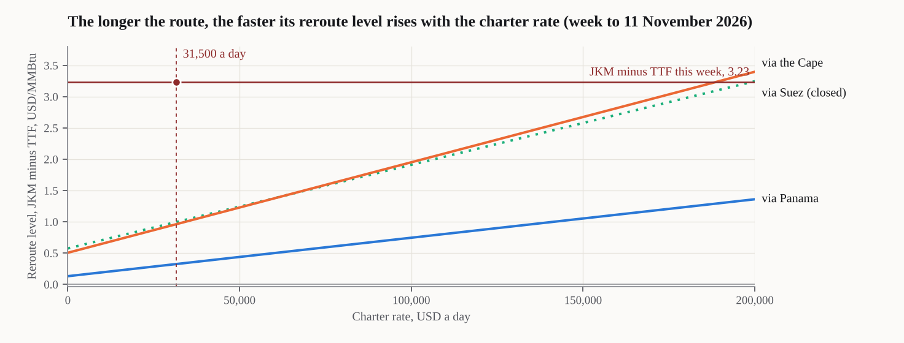

# JKM-TTF arbitrage study

When does a US Gulf LNG cargo pay to go to Asia instead of Europe? One cargo from Sabine Pass, netted back from Gate (sold against TTF) and from Futtsu (sold against JKM) via Panama, Suez or the Cape, gives the JKM minus TTF spread at which each route east pays as much as Europe.

**Site:** https://nathancouturier.github.io/jkm-ttf-arbitrage/ · **Note:** [two pages, PDF](JKM-TTF-Arbitrage-Research-Note.pdf)

<!-- finding:start -->
**Week to 11 November 2026.** JKM is 3.23 USD/MMBtu above TTF. At 31,500 USD a day, the last charter rate reported, on 2 October 2026, a cargo pays to go east above 0.19 via Panama and 0.82 via the Cape, so the arb is open on both routes. A cargo delivered to Northwest Europe sells 0.89 under TTF; without that discount the levels would be 1.10 and 1.75. With the ship already paid for the levels are -0.01 and 0.37. The arb via Panama closes above a charter rate of 526,282 USD a day.

Since September 2020 the spread has cleared the level of the cheapest open route in 151 of 289 weeks at the reported charter rate, and in 204 with the ship already paid for. After a month with the arb open, 30 percent of US LNG left for Japan, South Korea, China and Taiwan; after a closed month, 18 percent. The gap belongs to the years before 2022, when the arb was open in 60 months of 65 and the share was 35 percent; since 2022 it is 17 percent after an open month and 18 after a closed one.
<!-- finding:end -->



## Method in five lines

```
loaded    = capacity x fill x MMBtu per m3               174,000 m3 x 98.5 percent x 23
delivered = loaded - boil-off a day x round trip days    the boil-off is the ship's fuel
netback   = (DES price x delivered - hire - ports - tolls - carbon - financing) / loaded
S*(route) = the JKM minus TTF spread at which netback(Asia, route) = netback(Europe)
H*(route) = the charter rate at which the two netbacks are equal at today's prices
```

Europe's DES price is TTF less the discount ACER assesses, the market's charge for regasification and entry; JKM is a delivered price. Hire runs for the round trip, as in Spark30S, whose worked example the model reproduces to the dollar. The lift test sets the best netback against 115 percent of Henry Hub, the liquefaction fee being sunk. The model is [`src/arb/engine.py`](src/arb/engine.py), copied line for line into the browser and held to it by a test; every parameter and its source is in [`data/params.json`](data/params.json).

## Run it

```
pip install -r requirements.txt
make            # builds the site's data, runs the tests, writes the note
make serve      # http://localhost:8000/jkm-ttf-arbitrage/
```

Python 3.12 or later, and Node for one test. A weekly workflow runs `make refresh`: each source on its own, kept only if the study still builds on it. A push to `main` tests, builds and publishes `site/`. A charter rate no headline states is one line added by hand to `data/charter_rates.csv`.

## Data and credits

| Series | Source and credit |
|---|---|
| Gas&nbsp;prices | U.S. Energy Information Administration (JKM, TTF, Henry Hub), which credits the prices to Bloomberg Finance L.P. and Henry Hub to Refinitiv, an LSEG business |
| DES&nbsp;LNG | European Union Agency for the Cooperation of Energy Regulators (ACER), Northwest Europe |
| Charter&nbsp;rates | Spark Commodities, as reported by LNG Prime and by Reuters in gCaptain |
| US&nbsp;LNG&nbsp;cargoes | U.S. Department of Energy |
| Japan&nbsp;spot&nbsp;LNG | Created by processing the information in the Spot LNG Price Statistics (Ministry of Economy, Trade and Industry of Japan) |
| TTF,&nbsp;monthly | The World Bank: Commodity Price Data (The Pink Sheet): Bloomberg Finance L.P.; World Gas Intelligence; Thomson Reuters Datastream; The Wall Street Journal; Official Statistics of Japan; World Bank, CC BY 4.0. The World Bank does not endorse this study |
| EU&nbsp;allowances | European Commission auction reports, CC BY 4.0; Source: EEX, DEHSt, CC BY-NC-ND 4.0, the monthly averages reproduced unchanged |
| FX,&nbsp;SOFR,&nbsp;SDR | Board of Governors of the Federal Reserve System, H.10; Federal Reserve Bank of New York; International Monetary Fund, through the Deutsche Bundesbank |
| Canals | Panama Canal Authority; Suez Canal Authority |

Routes: searoute (Apache License 2.0) over Eurostat's SeaRoute network (EUPL 1.2). Land: Natural Earth through world-atlas (ISC). Charts: D3 (ISC). Typefaces: SIL Open Font License. Platts' figures are quoted from the publications that republished them. Code: MIT licence; other publishers' terms are set out in [`NOTICE`](NOTICE).

**Limits.** The charter rate is one published assessment, held between reports. Europe's DES discount is ACER's assessment; before 2023 it is an assumption. Panama is priced at the tariff with a booked slot. Prices are weekly averages of front months, flows show association and not cause, and nothing here is a forecast or a trading signal.
